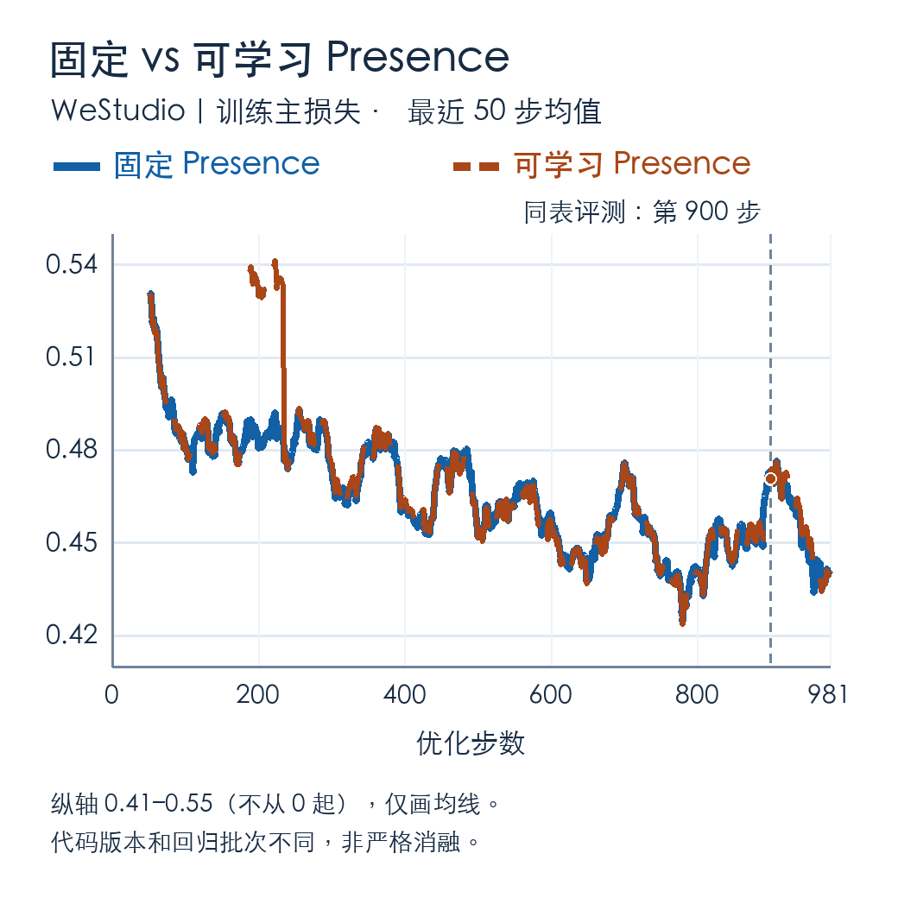
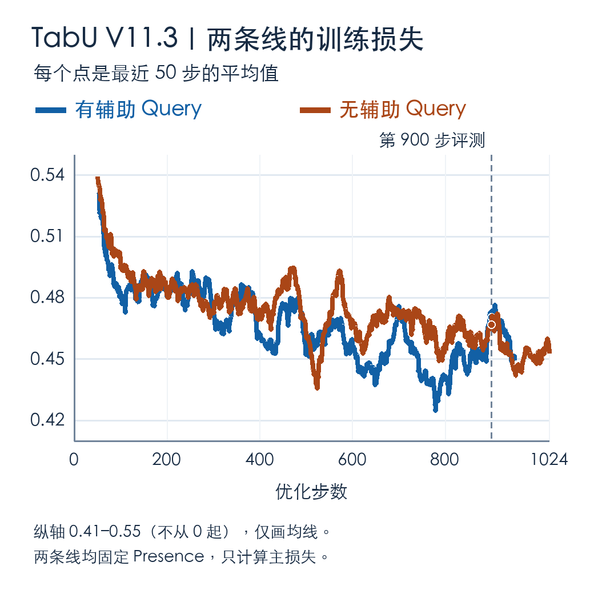

# TabU 消融札记：多一个参数，多一行数据，真的值得吗？

给模型加东西时，我总能想出它为什么可能有用。真正难的是问：如果拿掉它，我到底会失去什么？这次 TabU V11.3 的消融，我想弄清两件事。

## 一个可能晚一点赢的参数

OTransformer 有个量叫 Presence，可以理解为一条信息有多大程度参与这次更新。最简单的做法是由向量范数决定；另一种做法是先用一个投影变换向量，再算范数，让这个投影也能学习。两种方案从单位投影出发，固定投影不等于把参与度固定为 1。

我的预期是，可学习版可能起步慢一点，训得更久后，才有机会靠更丰富的表达反超。我看过的曲线给了我一点这样的直觉，但眼下两条新线用的都是固定投影，不能拿来证明反超。值得做的对照很明确：同一个起点、同一批训练表，只改变投影能不能学，再分别比较同一步数和同一训练时间的表现。

## 一行我想保留的数据，一份反而可能添乱的损失

辅助 Query 是把一条带标签的 Context 行复制一份，把标签遮住。它和真正要预测的行一样，在跨行交互时只接收信息。到读出阶段，我再把它的表征和原件的标签配起来，用它帮助拟合这张表的预测规律。我喜欢它，是因为**用来学规律的点和真正要预测的点，可以用同一种方式构造**。代价也很实在：即使特征相同，多出来的行也要重新计算。

我们把两条现成的第 900 步权重放到同一套 12 张真实开发表上。两边都没有辅助损失：有辅助 Query 的版本二分类 AUC 是 **0.6846**，没有的是 **0.6838**，几乎持平；多分类概率损失略低，平均回归 R² 却是 **0.698 对 0.756**，差距几乎都来自一张表。两条线的训练损失都在下降，硬件和列读取方式又不一样。这组结果值得追，但还不能归因给辅助 Query。

更反直觉的是，**留着这行，和给它加一份训练损失，是两件事。** 主辅各占一半的那次，训练频繁触发梯度裁剪。换成小权重、把原件真正留出后，有些指标出现改善，但随保存点变化，还要多花不少时间。为什么有时有帮助、有时却让训练更不稳？这个问题还没解开。

所以我暂时不打开辅助损失，也不凭这一次把辅助 Query 删掉。下一轮先验证 Presence 能不能后来居上，再在同一台机器上，只改辅助 Query 的有无。我要知道的不是哪一版更复杂，而是哪一份复杂度真的值它花掉的算力。
